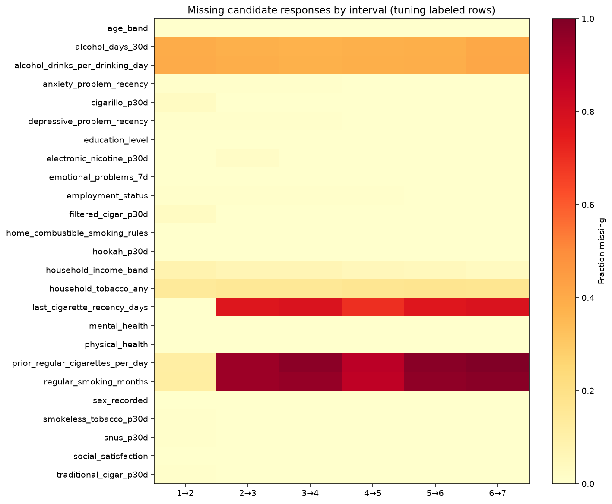
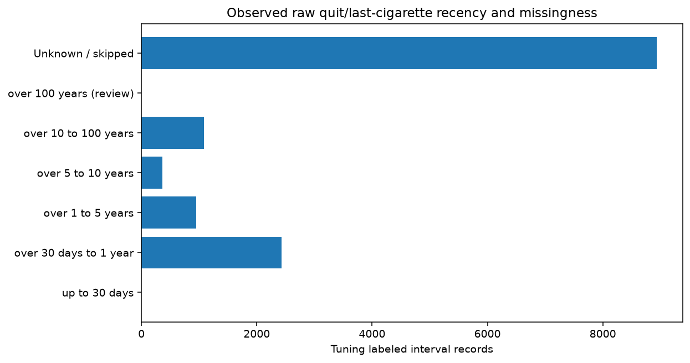
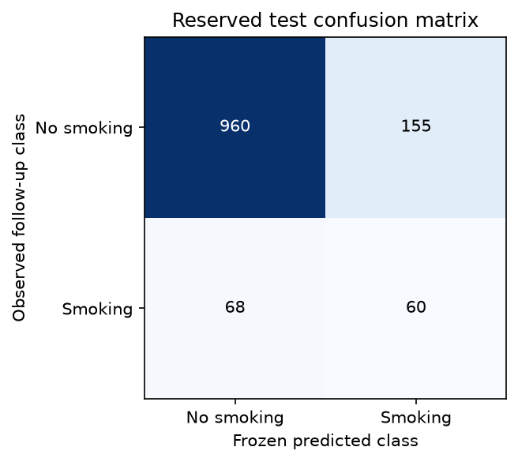
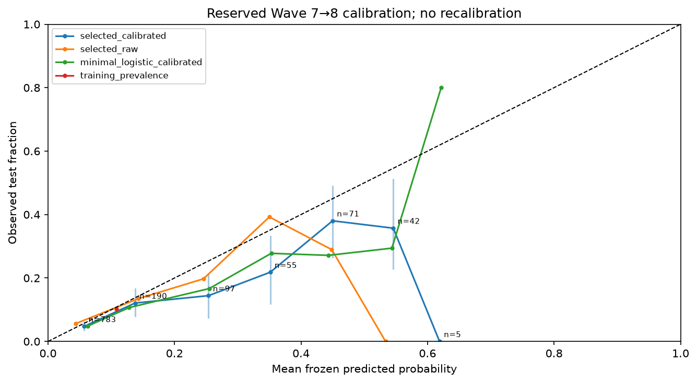
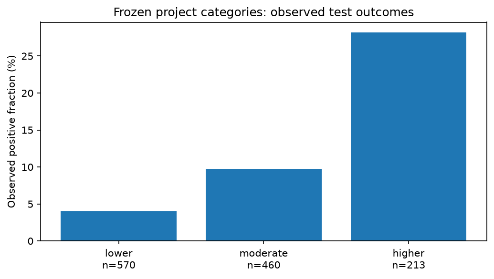

# Explainable prediction of next-survey cigarette smoking

CSE366 research project. This report uses executed, saved results. It does not claim clinical validation, national representativeness, causal intervention effects or an exact relapse clock.

## Research question and endpoint

Among adult former established cigarette smokers with no reported cigarette use in the past 30 days at a starting interview, can baseline information predict cigarette smoking in the 30 days before the next scheduled interview, conditional on an observed valid outcome?

Prediction occurs at the end of the starting interview. Cohort membership uses the documented official former-established indicator plus baseline past-30-day No. Follow-up past-30-day Yes becomes 1 and No becomes 0; absent/invalid follow-up remains unobserved. Labels are survey responses, not adjudicated biological events. “Next-survey smoking status” differs from any temporary resumption between interviews and from persistent relapse. A negative window does not prove continuous abstinence. Separate current-established and recent-recency definitions are documented, not substituted for the primary endpoint. Exact local variables, physical PDF pages and eligibility rules are in [the specification](prediction_specification.md).

## Related work and contribution

A PATH Random Forest relapse study already exists [1]. Its abstract reports race-specific AUCs 0.77, 0.88 and 0.70 (White, Black and Hispanic groups); these are not overall accuracy or targets for our different cohort. Its public abstract conflicts on follow-up length; we do not adopt that timing. Full methods were subscription-restricted.

A PATH cessation study [2] reports a best RF-with-bagging balanced accuracy of 72% and ROC-AUC 0.76 in its full-text Discussion. It predicts quitting among current smokers, whereas our target is next-survey use among former smokers. Its use of some follow-up information also changes the prediction-time question. These metrics are not directly comparable to ours.

Our course contribution is a reproducible, documented multi-wave cohort, strict held-out-person/later-wave evaluation, compact app and explanations of an actual calibrated score. It is not the first PATH relapse model and does not establish algorithmic superiority or a new clinical service. Verification details and publication ambiguity are recorded in [the literature record](../reports/literature_verification.json).

## Local dataset and source verification

Eight adult TSVs are selected from `PATH/DS1001` through `PATH/DS8001`. Wave row counts are 32,320; 28,362; 28,148; 33,822; 34,309; 30,516; 30,801; and 31,477. These are wave respondent counts, not numbers to sum as unique people. The 45,971 figure in the original proposal includes adults and youth and is not the local adult baseline size. Byte-identical `PATH/TSV` copies are excluded. PERSONID is a stable string join/group key, never a predictor. Per-wave IDs are checked for uniqueness and joins fail on multiplicity.

Local codebooks/questionnaires, revisions and missing/skip codes were verified, including revised former-smoking fields in Waves 2–3 and Wave 2 raw recency units/skip error. No all-eight-wave intersection is required. Source filenames/hashes and documentation pages are traceable through [the inventory](data_inventory.md), [mapping notes](feature_mapping_notes.md) and [dictionary](feature_dictionary.csv). Later-wave design/weight files needed for this analysis are absent; we do not turn PATH's study design into a national-estimate claim. Original inputs/PPTX were preserved; the intentional runner-instruction checksum exception is separately documented.

## Cohort flow

One record represents one eligible person and adjacent interview pair. This full cohort table is a saved construction diagnostic, not a development-only exploration or a national relapse rate.

| Pair | Eligible baseline | Unobserved next outcome | Labeled | Positive | Labeled prevalence |
|---|---:|---:|---:|---:|---:|
| 1-2 | 4,401 | 717 | 3,684 | 416 | 11.29% |
| 2-3 | 4,580 | 490 | 4,090 | 447 | 10.93% |
| 3-4 | 4,685 | 521 | 4,164 | 505 | 12.13% |
| 4-5 | 5,470 | 748 | 4,722 | 563 | 11.92% |
| 5-6 | 5,847 | 1,384 | 4,463 | 393 | 8.81% |
| 6-7 | 5,854 | 993 | 4,861 | 478 | 9.83% |
| 7-8 | 5,802 | 896 | 4,906 | 456 | 9.29% |

Total: **36,639 eligible intervals**, **5,749 unobserved**, **30,890 labeled intervals from 9,597 people**, **3,258 positive outcomes**. Missing follow-up is not negative. Detailed exclusions and secondary outcomes are in [cohort flow JSON](../reports/cohort_v1/cohort_flow.json). The legacy `.analysis/cohort_counts.json` matched the primary counts as a diagnostic; no code forced those numbers. Repeated intervals are not independent people.

## Feature definitions and missingness

The initial dictionary has 25 candidates spanning demographics, quit history, smoking intensity, other products, household and health/behavior responses. Development-only decisions retained an eleven-input app-compatible comparison and a four-input minimal profile. The selected deployed research model uses the **four**, not all eleven or the 25 survey-only candidates. There is no deployed historical research model filled with invented answers.

| Selected input | Meaning / app domain |
|---|---|
| Age band | 18–24, 25–34, 35–44, 45–54, 55–64, 65+ |
| Education | Less than high school; GED; high-school graduate; some college/associate; bachelor/advanced |
| Employment | Full-time ≥35 hours/week; part-time 15–34; part-time under 15; not working for pay |
| Last-cigarette recency | Positive whole number and documented unit; approximate months =30.4375 days, years =365.25 days; unknown remains missing |

The app uses documented Wave 7 wording/entry limits (1–99 whole units). Wave 1 recency is time since completely quitting; later waves use last cigarette. Persistent former smokers often were not asked. Wave 2 lacks the same derived duration field and has a documented skip problem: raw day/month responses are used only when observed. There is no missing-to-zero conversion or undocumented historical carry-forward.

In labeled tuning intervals, observed recency falls from 99.7% at Wave 1 to 23.1%, 22.1%, 30.3%, 23.7% and 22.2% at later starting waves. This is largely instrument/routing-dependent availability, not ordinary random nonresponse. A fully answered new-user form can therefore differ materially from the survey training distribution. Raw source missing reasons distinguish refusal, unknown, structural skip and valid zero where relevant; downstream numeric median/missing-indicator and categorical missing-level handling are fitted inside training folds. Exact options/reasons and all candidate definitions are in [app questions](app_questions.md) and [final dictionary](feature_dictionary_final.csv).

Baseline-characteristic comparisons of the eligible tuning ledger found different follow-up availability by age (78.7% at 18–24 versus 88.5% at 55–64). This describes possible attrition selection, not its causes or a correction for it. Prior-intensity/alcohol outlier flags are retained as descriptive checks in [the development summary](../reports/development_data_summary.md); those fields are not selected app inputs. No test-driven clipping or feature choice occurred.

## Leakage prevention and evaluation protocol

Participants are assigned by deterministic label-blind hash, seed 366. Development uses starting Waves 1–6 only; a participant never crosses training/validation/calibration/threshold/test boundaries. Every held-out person's earlier records are excluded from fitting. Later-wave records from development people are not part of the strict test. Only held-out eligible Wave 7→8 records are evaluated externally.

| Purpose | Observed intervals | People | Positive intervals |
|---|---:|---:|---:|
| Tuning / five grouped folds | 13,757 | 4,692 | 1,487 |
| Separate sigmoid calibration | 2,801 | 947 | 312 |
| Separate operating threshold/categories | 2,910 | 990 | 336 |
| Reserved test | 1,243 | 1,243 | 128 |

These counts describe people observed in the respective time-restricted labeled samples; the wider assignment/ledger population also includes people without usable records. They must not be confused with all assigned-participant counts. Tuning exploration excludes calibration, threshold and test participants. Preprocessing/encoding/scaling/class ratios learn only from authorized training records. No future questionnaire answers, IDs, administrative fields or final outcomes enter predictors. Grouped internal validation estimates held-out-person performance in an earlier-wave mix, not a rolling forecast at every early time point.

Development selection gives each participant total metric weight one within a partition (1/n per repeated interval), with ordinary interval-weighted metrics also saved. Thus its weighted prevalence (0.2083) differs from ordinary tuning interval prevalence (0.1081); neither is a survey-weighted national rate. Class weighting is an imbalance experiment, not participant metric weighting or survey weighting. Final test has one interval per person, so participant/interval metrics coincide. See [the locked protocol](evaluation_protocol.md).

## Models and development selection

Executed models: training-prevalence-only; minimal/full-app logistic regression with unweighted/balanced variants; Random Forest and XGBoost with minimal/full-app profiles and weight variants. There is no class resampling/SMOTE. Random Forest bagging stays within training. The fixed tree budget was 16 configurations × five folds = 80 fits, seed 366, CPU one thread, no adaptive test-driven expansion or validation early stopping.

Selection used mean grouped-fold participant-equal **average precision**, with a fixed simplicity tie-break. Finite probability/loss checks and Brier/log-loss/calibration tradeoffs were required diagnostics, not a secretly changed ranking rule. The selected XGBoost has 180 depth-3 trees, learning rate 0.05, min_child_weight 10, lambda 5, full row/column sampling, no class reweighting. Its base refit uses tuning people; a sigmoid uses only separate calibration people. F1 operating threshold 0.2590049599706509 uses only the threshold group, with ties choosing the larger threshold. No personal-confidence estimate follows from that rule.

| Development candidate | Mean fold AP | Mean fold ROC-AUC | Mean fold raw Brier |
|---|---:|---:|---:|
| training_prevalence | 0.2083 | 0.5000 | 0.1750 |
| minimal_logistic | 0.4329 | 0.7759 | 0.1443 |
| app_logistic | 0.4251 | 0.7763 | 0.1446 |
| rf_minimal_s0_none | 0.4515 | 0.7797 | 0.1477 |
| rf_app_s0_none | 0.4465 | 0.7820 | 0.1512 |
| xgb_minimal_s1_none | 0.4539 | 0.7842 | 0.1416 |
| xgb_app_s1_none | 0.4523 | 0.7881 | 0.1414 |

These are raw development metrics, not the final calibrated test metrics. Small differences do not prove superiority. Fold SD is descriptive, not an independent confidence interval. The full 25-variable research profile is documented but was not run as an additional real-data trained comparison; do not claim it outperformed anything. Actual searches/configs/runtimes and family/profile tradeoffs are in [model selection](model_selection.md).

## Frozen final results

The feature schema, actual fitted models/calibrators, hyperparameters, risk cuts, timing decision and evaluation code were saved and hashed **before** the sole recorded test-answer access. Selected artifact SHA-256: `9b46cdb1783302c05c3b56b83d5695a1ad58b90da0614f04188ee687170eae36`. Model version: `xgb_minimal_s1_none:9b46cdb1783302c05c3b56b83d5695a1ad58b90da0614f04188ee687170eae36`. The complete exposure record and private predictions remain ignored under `artifacts/final_evaluation_v1/`. The test is now exposed and closed to tuning; no classifier, calibration or threshold was changed after evaluation.

**1,243 people, 128 positive, 1,115 negative; prevalence 10.30%.** The intervals below are conditional 95% percentile participant-bootstrap intervals, seed 366, 1,000 draws. All rows of a sampled person move together; repeated draws retain separate multiplicities. Undefined AP/ROC or zero-denominator threshold metrics are omitted only for that metric and valid/undefined replicate counts are saved. Primary selected-model metrics had 1,000 valid / 0 undefined draws. These intervals exclude model-selection, survey-design and full generalization uncertainty.

| Selected calibrated model metric | Point [95% interval] |
|---|---|
| Average precision | 0.2447 [0.1961, 0.3146] |
| ROC-AUC | 0.7392 [0.6955, 0.7810] |
| Brier score | 0.0885 [0.0782, 0.0993] |
| Precision | 0.2791 [0.2170, 0.3351] |
| Recall | 0.4688 [0.3828, 0.5547] |
| Specificity | 0.8610 [0.8415, 0.8805] |
| Log loss | 0.3051 [0.2751, 0.3365] |

Average precision is stepwise precision over recall increments, equivalent to `average_precision_score`, not trapezoidal PR-AUC. Its natural context here is positive prevalence 0.1030. At the frozen binary threshold: **TN 960, FP 155, FN 68, TP 60**. Always predicting No would appear 89.70% accurate while identifying no positive cases. That is why accuracy alone is inadequate; no new accuracy-based selection is made.

| Frozen candidate | AP [95% CI] | ROC-AUC [95% CI] | Brier [95% CI] |
|---|---|---|---|
| training_prevalence | 0.1030 [0.0869, 0.1199] | 0.5000 [0.5000, 0.5000] | 0.0924 [0.0798, 0.1056] |
| minimal_logistic | 0.2759 [0.2158, 0.3566] | 0.7367 [0.6897, 0.7801] | 0.0848 [0.0738, 0.0969] |
| app_logistic | 0.2796 [0.2196, 0.3589] | 0.7436 [0.6980, 0.7875] | 0.0846 [0.0733, 0.0967] |
| minimal_logistic_calibrated | 0.2759 [0.2158, 0.3566] | 0.7367 [0.6897, 0.7801] | 0.0880 [0.0777, 0.0988] |
| selected_raw | 0.2447 [0.1961, 0.3146] | 0.7392 [0.6955, 0.7810] | 0.0851 [0.0735, 0.0970] |
| selected_calibrated | 0.2447 [0.1961, 0.3146] | 0.7392 [0.6955, 0.7810] | 0.0885 [0.0782, 0.0993] |
| minimal_logistic_balanced | 0.2800 [0.2209, 0.3592] | 0.7407 [0.6938, 0.7827] | 0.1801 [0.1693, 0.1911] |
| app_logistic_balanced | 0.2822 [0.2238, 0.3624] | 0.7471 [0.7020, 0.7895] | 0.1841 [0.1726, 0.1956] |

The training-prevalence baseline outputs its training constant 0.1080904267, not the test prevalence. Balanced logistic variants have poor raw Brier scores; these uncalibrated outputs do not establish probability reliability or clinical usefulness. Several frozen logistic baselines have higher test AP than the selected tree. Paired differences are in [the final report](../reports/final_evaluation.md); we did not promote a new test winner.

## Calibration and risk categories

Mean calibrated estimate 13.90% exceeded observed 10.30%. The selected raw tree Brier 0.0851 was better than calibrated 0.0885: reserved development calibration did not transfer perfectly. Causes of this shift are hypotheses, not established findings. No recalibrator was fitted on test data.

Project-defined category cuts are 0.0750747765280418 and 0.2590049599706509, obtained from participant-weighted development score tertiles, not outcome-optimized medical cutoffs. Lower includes the lower cut; moderate includes the upper cut; higher is strictly above it. Binary classification uses ≥ its threshold, so exact-cut ties can be moderate yet binary-positive. Both rules are frozen and disclosed. Category rates below are observed-valid held-out Wave 7→8 denominators, not personal confidence or national risk.

| Category | People/records | Positive | Observed fraction | 95% interval |
|---|---:|---:|---:|---|
| lower | 570 | 23 | 4.04% | 2.46–5.79% |
| moderate | 460 | 45 | 9.78% | 7.17–12.61% |
| higher | 213 | 60 | 28.17% | 22.07–34.27% |

Recent observed recency subgroup 191 people / 57 positives had estimable metrics; longer observed recency 92/16 did not meet prespecified 100-person/20-positive/20-negative minima. Unknown recency 960/55 remains its own group, not long-term. Age/recorded-sex subgroup estimates/counts/CIs and suppressions are in the saved final report. These exploratory, selected and sometimes small strata cannot establish fairness or individual reliability.

## Explanations and demonstration

Exact SHAP explains the **actual calibrated wrapper probability**, not another candidate or underlying log-odds. Four original features are mapped to understandable questions; reference model output plus contributions reconstructs the score. Multiply probability-unit contributions by 100 for percentage-point attribution. Positive means upward relative to a fixed background model-output mixture, not that changing an answer causes a change in risk. The background is 64 tuning people, global explanation sample 128 separate tuning people; its mean prediction is not an observed reference smoking rate. [Global aggregate attribution values](../reports/outputs_v1/global_explanations.json) are development descriptions, not causal rankings.

The Streamlit app uses the trained schema and missing handling, freezes the same model hash/category rules, validates eligibility/recency, suppresses fewer than two supplied inputs, labels presets fictional and shows saved final metrics honestly. Answers are not persisted; only resources are cached. Unknown inputs and new-user missingness can differ from training routing. The user's local browser confirmation and automated synthetic model-identity tests are distinct forms of evidence; see [verification](../reports/verification.md).

## Timing decision and limitations

**Decision C: elapsed-time estimates unsupported.** Local headers/schema lack usable individual follow-up clocks and complete first-resumption histories. General wave collection periods cannot establish an individual's elapsed interval. Conditional retrospective questions may reveal past smoking or an approximate last attempt but cannot identify every post-baseline event. Quit recency is history, not future event time. No survival model, annual probability, imputed relapse date, midpoint event or fabricated censoring time is produced. See [timing feasibility](timing_feasibility.md) for exact local files/pages and [timing decision](timing_decision.md).

Limitations remain self-report error, variable follow-up spacing, questionnaire/revision differences, nonrandom observed follow-up, conditional history availability, repeated observations, limited search/sample/subgroup sizes, imperfect probability transfer and marginal-SHAP background mixtures that can be unrealistic. No matching pooled survey-weight/design implementation supports national inference. U.S. PATH-based results do not establish performance for Bangladesh, other populations or present-day new app users. Research software is not clinical guidance, treatment selection or a causal effect estimator. No target score was promised. A future change needs new development decisions and honest independent evaluation, not reuse of the exposed test as untouched.

## Reproducibility and conclusion

[README](../README.md) provides separate trained-app and research-rebuild paths. [Build order](build_order.md) and [verification](../reports/verification.md) distinguish fresh regenerated documentation/cohort/splits from frozen model replay. Executed checks: 132 full-suite tests, seven isolated real-artifact smoke checks, nine exact regenerated-output comparisons, 212 protected files unchanged. Fresh installation/cross-platform full search were not claimed. The original checksum baseline remains intact; 58/59 inputs match because the user intentionally edited only the orchestration runner, as recorded separately. Private inputs/models are excluded from sharing.

The project demonstrates a reproducible next-survey classifier with modest ranking ability and meaningful calibration limits. A simpler baseline's stronger test AP is a valid finding. The practical result is a transparent course demonstration and an auditable scientific workflow, not a clinical or time-to-relapse system.

## References and evidence

1. Dai HD, Qiu F, Dai R, Cheng X. *Machine Learning of Smoking Relapse: the Role of Racial Differences and E-Cigarette Vaping Characteristics on Former Smokers.* Journal of Racial and Ethnic Health Disparities 13(3): 1910–1928 (2026); online 21 March 2025. DOI 10.1007/s40615-025-02385-x. [Publisher](https://link.springer.com/article/10.1007/s40615-025-02385-x), [required PubMed record, PMID 40117048](https://pubmed.ncbi.nlm.nih.gov/40117048/). Public abstract verified; full methods access unavailable.
2. Issabakhsh M, Sánchez-Romero LM, Le TTT, Liber AC, Tan J, Li Y, et al. *Machine learning application for predicting smoking cessation among US adults: An analysis of waves 1-3 of the PATH study.* PLOS ONE 18(6):e0286883; 8 June 2023. [Publisher full text and DOI 10.1371/journal.pone.0286883](https://journals.plos.org/plosone/article?id=10.1371/journal.pone.0286883). Bibliographic/metric verification uses Citation and Discussion, not an ambiguous “accuracy” label in the abstract.
3. Local PATH evidence: [inventory](data_inventory.md), [endpoint/source pages](prediction_specification.md), [feature dictionary](feature_dictionary.csv), [timing source pages](timing_feasibility.md). These preserve source filenames/physical PDF page conventions and hashes; they are authoritative for the local data interpretation.
4. Project measured results: [cohort JSON](../reports/cohort_v1/cohort_flow.json), [tuning summary](../reports/development_data_summary.md), [tree results](../reports/trees_v1/results.json), [frozen final aggregate JSON](../reports/final_evaluation_v1/results.json), [exposure/integrity account](../reports/final_evaluation.md). No performance value in this report comes from a new evaluation.
