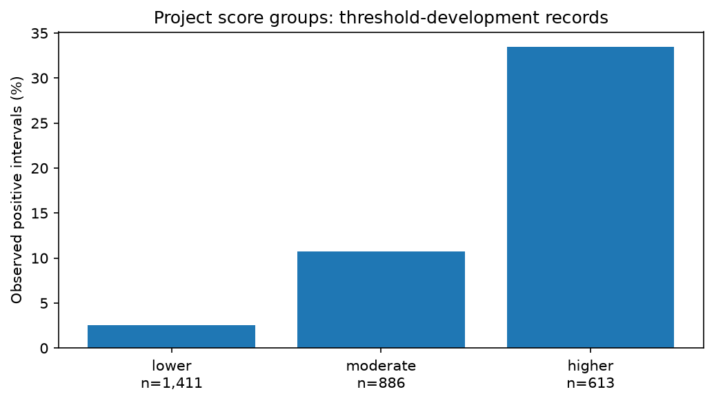
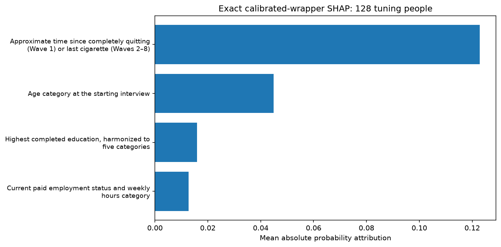

# Stage 10: understandable model outputs

These are project-defined relative score categories and model attributions, not established medical cutoffs, clinical advice, personal confidence estimates or causal effects. The retained model is the exact selected `xgb_minimal_s1_none` calibrated wrapper from stage 8. No model, calibrator, binary threshold or participant split is refitted. Final-test features/outcomes remain unopened.

## Frozen lower/moderate/higher groups

First score at which cumulative participant-equal weight reaches 1/3 and 2/3; thresholds use scores/weights only, never outcome optimization. Equal scores stay together. Lower <= cut1; moderate cut1 < p <= cut2; higher p > cut2.

Frozen cuts: **0.075074776528041801** and **0.25900495997065093** calibrated probability. Lower: p≤0.07507478; moderate: 0.07507478<p≤0.25900496; higher: p>0.25900496. Categories use unrounded probability; displayed decimal boundaries are explanatory only. These are empirical score tertiles, not arbitrary probability thirds or medical cutoffs.

The source cohort is **reserved threshold-selection participants**, former established smokers with no past-30-day cigarette use at a starting Wave 1–6 interview and a valid observed next-wave outcome. It has **2,910 interval records from 990 people, with 336 positive interval outcomes**. Interval prevalence is 336/2,910=11.55%; participant-equal prevalence is 21.51%, using total participant weight 990. These are different observed-data averages, not nationally representative risks.

Each participant contributes total weight one over all their threshold-group intervals; cut points use only calibrated scores and these weights. Outcomes are used afterward to describe the frozen groups, never to choose cutoffs or force monotonic observed rates. Tied scores remain together, so sizes need not be equal. Each group exceeds the prespecified 100-record descriptive minimum. Group rates are development descriptions on the category-definition sample, not independent validation or guarantees for a new user.

| Category | Interval records | Unique people appearing | Positive intervals | Observed interval fraction | Weight mass | Participant-weighted observed fraction |
|---|---:|---:|---:|---:|---:|---:|
| lower | 1,411 | 443 | 36 | 2.55% | 353.317 | 4.53% |
| moderate | 886 | 471 | 95 | 10.72% | 306.733 | 17.17% |
| higher | 613 | 455 | 205 | 33.44% | 329.950 | 43.72% |

Unique-person counts across bands overlap because one person can contribute intervals in different bands. Their sum must not be called the source cohort size. Interval rates use positive intervals/interval records; weighted rates use the fixed whole-source 1/n weights and each band’s listed weight mass, not its unique-person count. No confidence interval or significance claim is invented. The second score-tertile cut happens to equal the earlier F1 binary operating threshold here; it was obtained independently by the score-quantile rule, not by outcome optimization. At an exact upper cut, the category is moderate, while the separate binary rule uses ≥ its threshold; they answer different display questions.



## Exact explanations of the actual displayed probability

SHAP 0.54.1 ExactExplainer calls the saved calibrated wrapper’s positive-class `predict_proba` on the four original input features. The independent empirical background is 64 deterministic tuning intervals from 64 distinct people. A separate deterministic 128-person tuning sample supplies global summaries; background and global-sample participants do not overlap. Selection is by seeded key hashes only, never outcomes. There are only four inputs, so all 16 feature coalitions can be evaluated exactly. No different candidate, uncalibrated raw tree, log-odds margin or hidden replacement model is explained.

For each explained profile: **reference model probability + sum of four contributions = displayed calibrated probability**. Maximum numerical residual on the 128-person tuning sample was **8.88e-16** (tolerance 1e-8). The reference model probability is **0.191937**, the mean model output over those 64 tuning reference intervals; it is **not an observed event rate** or a universal population baseline.

Contributions are in probability units. Multiplying an attribution by 100 expresses its contribution in percentage points relative to this reference mixture, not an expected risk change from changing a response. No log-odds value is labeled as percentage points. Since the whole wrapper is called, the nonlinear sigmoid calibration, imputation, one-hot encoding and standardization are all inside the explanation path. A local explanation’s base value plus attributions is checked against the same score that determines the category.

Global mean absolute attributions in calibrated probability units:

| Question | Mean absolute contribution | Mean signed contribution |
|---|---:|---:|
| Approximate time since completely quitting (Wave 1) or last cigarette (Waves 2–8). | 0.122836 | 0.014718 |
| Age category at the starting interview. | 0.044921 | 0.007749 |
| Highest completed education, harmonized to five categories. | 0.015905 | -0.000833 |
| Current paid employment status and weekly hours category. | 0.012737 | 0.001679 |



The attribution target is at the original-question level. `reports/outputs_v1/transformed_question_mapping.json` separately maps every actual fitted one-hot category, standardized numeric and missing-indicator column back to these questions and readable source categories. No raw transformed-column SHAP values are summed and silently presented as calibrated-probability SHAP. The mapping is transformation provenance, while the four original-question SHAP values directly explain the complete wrapper.

Independent marginal SHAP can combine correlated answers in unrealistic ways, such as an age/quit-history pairing uncommon in the study. Background choice affects attribution. These are model behavior summaries, not causes, interventions, treatment effects or instructions for reducing risk. Missing recency often reflects routing; a new user’s full answers may differ from survey measurement. Global ranks on a tuning sample are not external validation.

## Valid fictional input-profile checks

The following profiles come from a clearly synthetic software fixture, not PATH people or observed outcomes. Predictions are real executions of the selected model; they are not accuracy evidence.

| Fictional profile | Status | Supplied model inputs | Calibrated probability | Category |
|---|---|---:|---:|---|
| fictional_recent_quitter | scored | 4/4 | 0.495265 | higher |
| fictional_one_year_history | scored | 4/4 | 0.217730 | moderate |
| fictional_longer_quit_history | scored | 4/4 | 0.088143 | moderate |
| fictional_not_asked_recency | scored | 3/4 | 0.048628 | lower |
| fictional_partial_answers | scored | 2/4 | 0.108453 | moderate |
| fictional_all_unknown | insufficient_input | 0/4 | withheld | none |
| fictional_unknown_eligibility | eligibility_unconfirmed | 2/4 | withheld | none |
| fictional_outside_cohort | outside_cohort | 2/4 | withheld | none |

### Local attribution examples (fictional profiles)

Each table explains the actual calibrated probability shown for that profile. Contributions sum with the named tuning-background model reference; they are not effects of changing answers.

**fictional_recent_quitter**: probability 0.495265; reference model output 0.191937; category higher.

| Question / supplied or missing answer | Signed probability attribution |
|---|---:|
| About how long has it been since you last smoked a cigarette? — 60.875 approximate days | +0.259434 |
| What is your age group at the starting interview? — 18–24 | +0.074848 |
| What is your current paid employment status and usual weekly hours category? — Part-time, 15–34 hours/week | -0.043752 |
| What is the highest level of education you have completed? — High school graduate | +0.012798 |

**fictional_not_asked_recency**: probability 0.048628; reference model output 0.191937; category lower.

| Question / supplied or missing answer | Signed probability attribution |
|---|---:|
| About how long has it been since you last smoked a cigarette? — Not supplied (app_not_previously_asked); uses trained missing handling | -0.096015 |
| What is your age group at the starting interview? — 55–64 | -0.045520 |
| What is your current paid employment status and usual weekly hours category? — Full-time, at least 35 hours/week | -0.004816 |
| What is the highest level of education you have completed? — High school graduate | +0.003042 |

Complete and partial eligible profiles receive finite explanations and matching categories. Missing answers retain separate unanswered/don’t-know/refused/not-applicable/not-previously-asked reasons; they are not zero or No. A missing-input attribution describes the model’s trained missing handling. At fewer than two supplied model inputs, with unknown eligibility or outside the cohort, probability/category are null and contributing factors empty, with an explicit suppression reason. Two-of-four is a transparent project usability guard, not a clinically validated accuracy threshold. Input completeness counts are never presented as personal confidence.

## Output contract and timing

See [output_contract.md](output_contract.md) and `configs/output_contract.json`. The response includes probability, endpoint, honest prediction interval, category and full-precision thresholds, readable contributing factors, input completeness/reasons, model/artifact version and limitations. Only the selected four questions are accepted; unused richer research inputs and identifiers are rejected. All four cohort eligibility gates must be confirmed. The model artifact SHA-256 is the same as the stage 9 pinned classifier. A frozen output manifest also pins category and background files.

Timing decision C remains enforced. No annual probability, exact relapse date, survival output or elapsed-time horizon is included. The endpoint is past-30-day smoking reported at the next scheduled interview, with unknown individual elapsed time; it is not every resumption or persistent relapse. Development calibration/category descriptions do not establish later-wave, clinical or new-user validity. No personal confidence percentage is provided.

## Reproducibility and saved outputs

Private ignored `artifacts/outputs_v1/` holds tuning background/global sample rows, global individual attributions and immutable manifest. Public `reports/outputs_v1/` contains only aggregate global/category summaries, transformed-question metadata, clearly fictional profile outputs and provenance. No real participant ID or real local profile is exposed in public reports. Frozen categories live in `configs/risk_categories_v1.json`; metadata/schema in `configs/output_contract.json`. No learned model parameters, sigmoid or prior threshold is changed.

```bash
.venv/bin/python scripts/build_outputs.py
.venv/bin/python scripts/verify_outputs.py
.venv/bin/python scripts/write_output_report.py
.venv/bin/python -m pytest -q -p no:cacheprovider
.venv/bin/python scripts/verify_timing.py
.venv/bin/python scripts/verify_evaluation_splits.py
.venv/bin/python scripts/verify_inputs.py
```

The build command verifies/reuses an existing matching output run; it refuses changed/incomplete inputs rather than silently regenerating bands/explanations. No new model fit or final-test evaluation occurs. Stop after stage 10 and await the next numbered prompt.
