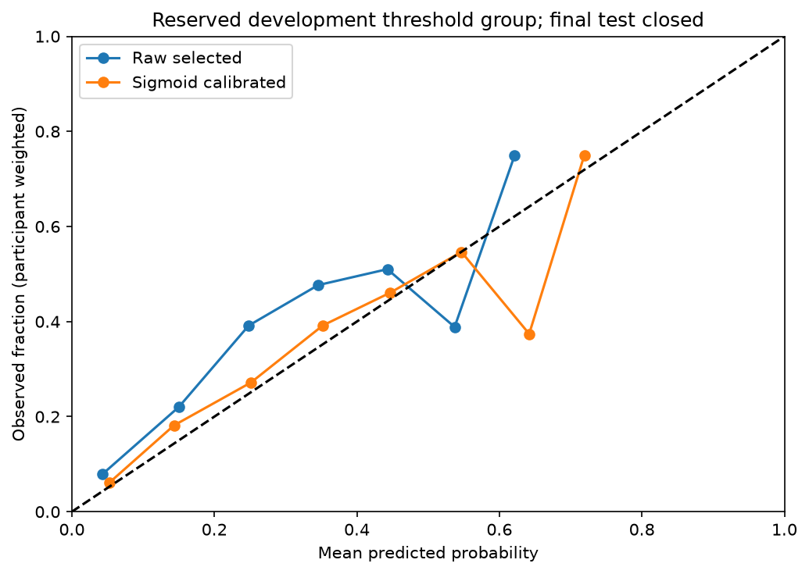

# Stage 8 model selection: tree models versus baselines

**Final-test features, outcomes and performance remain unopened.** All choices use the locked five tuning folds; calibration and threshold groups never rank classifiers. Original data, cohort, feature definitions, participant assignments and stage 7 models remain unchanged.

## Fixed search and fairness

Executed 80 fits for 16 new tree configurations, compared with five saved stage 7 candidates. XGBoost dependency status: `{'available': True, 'version': '3.4.1', 'alternative_used': False}`. XGBoost actually ran locally; no installation, network, API key or paid service was required. The fallback implementation is HistGradientBoostingClassifier only if XGBoost import is unavailable; it was exercised on synthetic data, not substituted for XGBoost in these real results.

Search budget fixed before fitting (`configs/tree_models.json`):

- Random Forest: 150 trees; max_features=sqrt; (max_depth=4, min_samples_leaf=20) or (max_depth=8, min_samples_leaf=10); unweighted or class_weight=balanced.
- XGBoost: histogram CPU trees, lambda=5, full row/column sampling; (120 trees, max_depth=2, learning_rate=0.05, min_child_weight=10) or (180 trees, max_depth=3, learning_rate=0.05, min_child_weight=10); scale_pos_weight=1 or training-fold negatives/positives.
- Both families: minimal four inputs and full selected eleven app inputs; seed 366, one CPU thread. Two paired complexity settings × two weight choices × two profiles × two families = 16 configurations × five folds = 80 fits. This is a modest paired search, not an exhaustive Cartesian search over every numerical parameter. No early stopping, adaptive search expansion or validation-driven preprocessing.

Each tree Pipeline reuses the same fold-fitted schema validation, categorical missing imputation/one-hot encoding, and numerical median/missing-indicator/scaling recipe as stage 7. Scaling is unnecessary for trees but retained for a common preprocessing comparison and does not use validation statistics. Unseen valid categories are ignored safely, and feature names are preserved. Learned imputation/encoding and class-weight ratios use training records only. No target encoding or future questionnaire information is introduced.

Every tree validation key/label was checked against the saved baselines for the same fold. No baseline was retrained. Base fits use unweighted records or training-only class weighting; evaluation metrics use participant-equal weights (1/n records) with interval-equal counterparts also saved. No targeted oversampling or SMOTE is used. Training folds have adequate positives (validation folds previously had 292–302); the weight experiment and observed probability distortion do not justify adding a more complex synthetic-data experiment. RF bootstrap is native training-only bagging, not class balancing. Validation/test prevalence and record membership are unchanged.

## Prespecified decision rule and probability quality

Preserve locked mean five-fold participant-weighted AP, exact ties use prespecified simplicity order: five saved baselines first, then listed tree candidates. Brier/log loss/calibration and ROC are mandatory tradeoff diagnostics, not an undisclosed new ranking objective.

Require finite bounded probabilities and finite Brier/log loss. Quantify raw probability quality against the prevalence baseline. A newly selected tree must receive the locked reserved sigmoid calibration before any app-ready probability claim; apparent calibration-fit and threshold-selection scores are labeled, never used to re-rank. No clinical risk claim or category is established.

Discrimination is ranked by mean participant-weighted **average_precision_score**, not trapezoidal PR-AUC. Existing baseline simplicity order precedes ordered tree configurations for exact ties. Brier/log loss, mean prediction versus prevalence, calibration bins and ROC-AUC are reported for every candidate. They inform the probability-readiness/calibration decision and explain tradeoffs; they are not an undisclosed new composite objective or a reason to tune against reserved groups. Finite bounded probabilities and finite losses are required. No target score is promised.

Mean-fold participant-equal prevalence context: **0.2083** (ordinary tuning interval prevalence was 0.1081). These are different repeated-record estimands; they must not be interchanged or presented as survey-weighted national risk.

| Candidate | Mean fold AP | AP fold SD | ROC-AUC | Brier | Log loss | Five-fold fit seconds |
|---|---:|---:|---:|---:|---:|---:|
| training_prevalence | 0.2083 | 0.0110 | 0.5000 | 0.1750 | 0.5542 | not recorded |
| minimal_logistic | 0.4329 | 0.0341 | 0.7759 | 0.1443 | 0.4478 | not recorded |
| minimal_logistic_balanced | 0.4275 | 0.0361 | 0.7741 | 0.2206 | 0.6406 | not recorded |
| app_logistic | 0.4251 | 0.0256 | 0.7763 | 0.1446 | 0.4474 | not recorded |
| app_logistic_balanced | 0.4194 | 0.0242 | 0.7739 | 0.2205 | 0.6422 | not recorded |
| rf_minimal_s0_none | 0.4515 | 0.0422 | 0.7797 | 0.1477 | 0.4542 | 1.412 |
| rf_minimal_s0_balanced | 0.4464 | 0.0441 | 0.7806 | 0.2130 | 0.6185 | 1.913 |
| rf_app_s0_none | 0.4465 | 0.0435 | 0.7820 | 0.1512 | 0.4624 | 1.709 |
| rf_app_s0_balanced | 0.4392 | 0.0429 | 0.7820 | 0.2141 | 0.6201 | 2.217 |
| rf_minimal_s1_none | 0.4506 | 0.0412 | 0.7813 | 0.1436 | 0.4438 | 1.708 |
| rf_minimal_s1_balanced | 0.4460 | 0.0422 | 0.7803 | 0.2118 | 0.6143 | 2.182 |
| rf_app_s1_none | 0.4449 | 0.0394 | 0.7856 | 0.1455 | 0.4460 | 2.329 |
| rf_app_s1_balanced | 0.4416 | 0.0427 | 0.7855 | 0.2062 | 0.6004 | 2.683 |
| xgb_minimal_s0_none | 0.4488 | 0.0334 | 0.7845 | 0.1424 | 0.4417 | 0.352 |
| xgb_minimal_s0_balanced | 0.4503 | 0.0324 | 0.7848 | 0.2134 | 0.6206 | 0.334 |
| xgb_app_s0_none | 0.4509 | 0.0321 | 0.7884 | 0.1423 | 0.4400 | 0.595 |
| xgb_app_s0_balanced | 0.4507 | 0.0331 | 0.7880 | 0.2112 | 0.6155 | 0.680 |
| xgb_minimal_s1_none | 0.4539 | 0.0306 | 0.7842 | 0.1416 | 0.4404 | 0.473 |
| xgb_minimal_s1_balanced | 0.4527 | 0.0308 | 0.7839 | 0.2147 | 0.6215 | 0.461 |
| xgb_app_s1_none | 0.4523 | 0.0218 | 0.7881 | 0.1414 | 0.4376 | 0.793 |
| xgb_app_s1_balanced | 0.4459 | 0.0259 | 0.7862 | 0.2107 | 0.6118 | 0.788 |

Total executed tree workflow elapsed time: **29.963 seconds** on this local machine, including loading, prediction, serialization, four refits and reserved calibration. Per-fold fit/prediction times are recorded individually. Timing is measured by perf_counter and is hardware/load dependent; it is not a universal benchmark. Stage 7 baseline timing was not recorded, so it is explicitly missing rather than fabricated or measured by retraining.

## Minimal versus full-feature comparisons

| Family | Best minimal candidate | AP | Brier | Best full candidate | AP | Brier |
|---|---|---:|---:|---|---:|---:|
| baseline | minimal_logistic | 0.4329 | 0.1443 | app_logistic | 0.4251 | 0.1446 |
| random_forest | rf_minimal_s0_none | 0.4515 | 0.1477 | rf_app_s0_none | 0.4465 | 0.1512 |
| xgboost | xgb_minimal_s1_none | 0.4539 | 0.1416 | xgb_app_s1_none | 0.4523 | 0.1414 |

## Selected candidate and tradeoffs

Selected **xgb_minimal_s1_none** by tuning CV only. Its mean AP=0.453882, ROC-AUC=0.784236, Brier=0.141601, versus minimal logistic AP=0.432941 and Brier=0.144294. Exact selected search parameters: `{'objective': 'binary:logistic', 'eval_metric': 'logloss', 'tree_method': 'hist', 'device': 'cpu', 'n_jobs': 1, 'subsample': 1.0, 'colsample_bytree': 1.0, 'reg_lambda': 5.0, 'verbosity': 0, 'n_estimators': 180, 'max_depth': 3, 'learning_rate': 0.05, 'min_child_weight': 10}`.

The selected model uses only age band, education, employment and observed raw quit/last-cigarette recency. This reduces question burden and avoids fabricated historical answers. The eleven-feature full app comparison is retained; the survey-only 25-feature research model is not silently used by the app. The full unweighted depth-3 XGBoost has slightly better raw Brier (0.141388) but slightly lower AP (0.452306), so it does not replace the AP winner. A Random Forest also approaches the winning AP. These small differences across a single fixed five-fold search do not establish statistically significant superiority, clinical utility or later-wave performance. Fold SD is descriptive, not an independent confidence interval. More candidate comparisons can make internal winner estimates optimistic; no bootstrap/CI or significance claim is invented.

Class-weighted trees generally predict much higher raw probabilities and have worse Brier in this run; weighting can help ranking/recall without preserving probability calibration. No observation is removed or label rebalanced in evaluation. The selected unweighted model still underestimates participant-equal development prevalence, so the locked sigmoid procedure is applied. Class weights are not survey weights and do not supply population representativeness.



## Reserved calibration and operating threshold

Selected classifier by tuning AP before opening reserved groups; new sigmoid fitted only on calibration participants; threshold only on threshold group.

The selected base estimator fits tuning people only. The new selected-tree sigmoid uses 2,801 calibration records from 947 different people, then the threshold uses 2,910 records from 990 further people. No calibration example/person was used to fit that base model. The groups previously supported the stage 7 baseline diagnostic; their reuse for the prespecified new classifier’s fixed sigmoid does not authorize classifier/hyperparameter/feature selection using them. Neither new nor old reserved-group results re-rank this comparison. No repeated final-test evaluation occurs.

| Threshold-group participant-equal metric | Raw selected | Sigmoid calibrated |
|---|---:|---:|
| prevalence | 0.2151 | 0.2151 |
| average_precision | 0.4454 | 0.4454 |
| roc_auc | 0.7824 | 0.7824 |
| brier | 0.1462 | 0.1409 |
| log_loss | 0.4518 | 0.4347 |
| mean_predicted_probability | 0.1503 | 0.2019 |

Calibrated threshold **0.259005** selected by participant-weighted F1 (largest threshold on ties). Apparent selection-set F1=0.5347, precision=0.4391, sensitivity=0.6837, specificity=0.7606. These metrics are apparent for threshold selection, not independent operating guarantees. Calibration-fit metrics are also explicitly labeled apparent. No low/medium/high risk categories or personal confidence percentage is validated.

The reserved threshold-group AP is 0.4454, slightly below the stage 7 selected baseline’s 0.4493, while its Brier/ROC tradeoffs differ. This is reported honestly, not used to reverse the tuning-only selection or launch another search. Sparse probability bins and cross-wave/routing shifts limit interpretation; future user applicability and later-wave calibration remain unknown. No outcome dates, persistent-relapse claims or fixed-year risks are created.

## Saved files and reproducibility

Ignored `artifacts/trees_v1/` contains all 80 searched fold Pipelines, four best-family/profile tuning refits, selected calibrated bundle, local OOF/calibration/threshold predictions and immutable manifest. Aggregate results/configurations/runtimes, fold metrics and provenance are in `reports/trees_v1/`. `configs/tree_models.json` is the exact fixed search space and probability-quality policy. Models/predictions/identifiers remain ignored; public reports contain aggregate results only. Dependency versions, seeds, code/config/baseline/split hashes and measured runtimes are recorded. No service, commit, upload or deployment occurred.

```bash
.venv/bin/python scripts/train_tree_models.py
.venv/bin/python scripts/verify_tree_models.py
.venv/bin/python scripts/write_model_selection.py
.venv/bin/python -m pytest -q -p no:cacheprovider
.venv/bin/python scripts/verify_evaluation_splits.py
.venv/bin/python scripts/verify_inputs.py
```

The training command verifies/reuses a completed identical run and refuses changed/incomplete outputs; it does not silently refit. The verifier scores saved development artifacts only, checking probabilities/metrics, training-only medians and class ratios, exact fold membership, feature schema, selection and calibration boundaries. Synthetic tests cover RF/XGBoost and the optional fallback, safe categories/serialization, training-only weight ratios and the locked selection rule. No final-test performance is produced. Stop at stage 8 and await the next numbered prompt.
