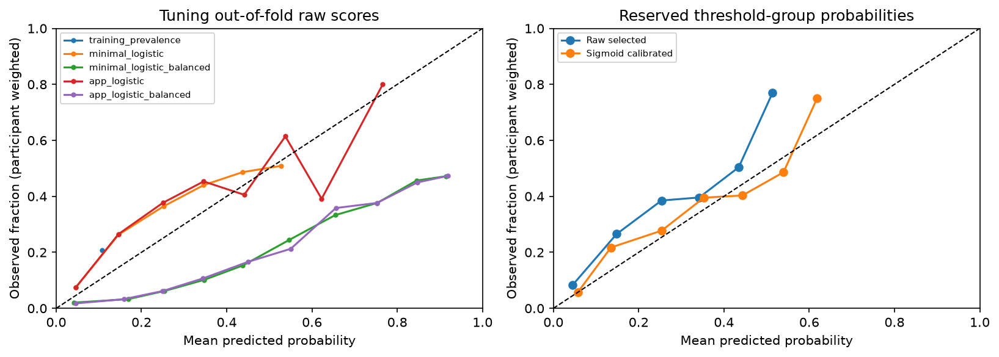

# Stage 7 baseline development results

**Development only. No final-test features, outcomes or performance inspected.** The frozen stage 5 participant assignment and stage 6 profiles are unchanged. Models predict next-survey past-30-day cigarette smoking, not exact relapse time, persistent relapse or fixed-year risk. Results are unweighted with respect to survey design and do not establish national representativeness or clinical validity.

## Models and training boundaries

Executed five locked participant-grouped folds on 13,757 tuning intervals from 4,692 people. Fit a training-prevalence baseline, a four-feature logistic regression, and an eleven-feature full selected app logistic regression. Each logistic has unweighted and training-only balanced-class-weight variants. C=1, lbfgs, 2,000 maximum iterations, seed 366 and one configured CPU thread were fixed before fitting; no broad tuning search or evaluation-set resampling. The 25-feature survey-only research comparison is separate and is not trained in this baseline stage.

Minimal inputs: age band, education, employment and observed raw quit/last-cigarette recency. Full selected inputs: all eleven finalized app-compatible features in `configs/feature_mapping_final.json`. The smaller model is a valid app-compatible subset; the requested eleven-question contract remains available for the full comparison.

Every fit clones an entire sklearn Pipeline on authorized training keys: feature-schema validation → categorical constant-missing imputation and one-hot encoding, plus numeric median/missing-indicator imputation and standard scaling → classifier. No imputer, encoder or scaler sees validation/calibration/threshold people while fitting a base model. Encoders ignore unseen valid categories safely; undocumented category codes or identifiers/outcomes in predictor input fail. Original distinct skip/no-answer metadata remains in the processed data but is not silently added as a predictor. Model-level categorical missing values share an explicit missing category; numeric missingness has an indicator. For an entirely missing numeric training column, sklearn keeps a zero-filled constant with a missing indicator, not an invented user answer.

## PR metric and prevalence context

sklearn.metrics.average_precision_score: stepwise precision weighted by recall increments, not trapezoidal PR-AUC.

Primary selection metrics give each evaluated participant total weight one: each of n observed intervals has weight 1/n. Ordinary interval-equal metrics are also saved. These estimate different observed-data averages. Participant-equal prevalence is higher here than interval prevalence because people contribute different numbers of eligible intervals. Class weights, participant metric weights and PATH survey weights serve different purposes.

| Model | Mean fold participant AP | Fold SD (descriptive) | ROC-AUC | Brier | Mean predicted probability |
|---|---:|---:|---:|---:|---:|
| training_prevalence | 0.2083 | 0.0110 | 0.5000 | 0.1750 | 0.1081 |
| minimal_logistic | 0.4329 | 0.0341 | 0.7759 | 0.1443 | 0.1478 |
| minimal_logistic_balanced | 0.4275 | 0.0361 | 0.7741 | 0.2206 | 0.4762 |
| app_logistic | 0.4251 | 0.0256 | 0.7763 | 0.1446 | 0.1487 |
| app_logistic_balanced | 0.4194 | 0.0242 | 0.7739 | 0.2205 | 0.4732 |

Mean fold participant-equal validation prevalence is **0.2083**; pooled interval-equal tuning prevalence is **0.1081**. AP of the constant baseline equals each fold's evaluation prevalence under its metric weights, even though the probability itself comes only from training labels.

The prevalence-only model is `DummyClassifier(strategy="prior")`, fitted without class or participant weights. Its constant probability is the empirical **training interval** prevalence, never the validation prevalence. Each saved fold probability is checked against the corresponding training-label mean. Because training prevalence differs slightly across folds, pooled out-of-fold baseline scores are not one globally constant score; use the mean per-fold baseline AP/ROC for interpretation and selection.

| Validation fold | Training prevalence used by baseline | Validation interval prevalence | Validation participant-equal prevalence |
|---|---:|---:|---:|
| 0 | 0.1091 | 0.1043 | 0.2053 |
| 1 | 0.1064 | 0.1153 | 0.2197 |
| 2 | 0.1059 | 0.1179 | 0.2188 |
| 3 | 0.1093 | 0.1035 | 0.1933 |
| 4 | 0.1099 | 0.1013 | 0.2045 |

Selected baseline: **minimal_logistic**, using mean five-fold participant-weighted AP and the prespecified simplicity order only on exact ties. Calibration/threshold results did not choose the model. Fold SD is descriptive, not an independent-sample confidence interval; no cluster-bootstrap interval is reported here. Internal CV is model-selection evidence, not an unbiased final performance estimate. The profiles were fixed from source meaning and tuning-only descriptive exploration before these model fits; there was no outcome-ranked feature screening.

Balanced class weighting increased raw predicted probabilities and worsened development Brier scores in this run, without improving the selection AP. Class weighting can change the probability target even when ranking is similar; a 0.5 cutoff on a class-weighted score is not automatically a calibrated risk decision. No oversampling or prevalence correction was applied to any evaluation rows. The selected unweighted model also shows a probability-target mismatch relative to participant-equal prevalence, motivating the reserved calibration procedure rather than an invented confidence adjustment.

## Threshold diagnostics before optimization

These are mean fold participant-weighted metrics at the **fixed 0.5 threshold**, not fold-optimized operating points. Full confusion matrices and interval-equal counterparts are saved in aggregate JSON.

| Model | Precision | Sensitivity | Specificity | F1 |
|---|---:|---:|---:|---:|
| training_prevalence | 0.0000 | 0.0000 | 1.0000 | 0.0000 |
| minimal_logistic | 0.6074 | 0.0159 | 0.9959 | 0.0308 |
| minimal_logistic_balanced | 0.3760 | 0.7988 | 0.6513 | 0.5111 |
| app_logistic | 0.5854 | 0.0453 | 0.9919 | 0.0839 |
| app_logistic_balanced | 0.3763 | 0.7921 | 0.6545 | 0.5099 |

## Reserved calibration and threshold procedure

Refitted each fixed candidate on tuning people only. The selected base model is frozen before sigmoid calibration. The calibrator fits logit(raw probability), clipped to [1e-6, 1−1e-6], using **2,801 calibration records from 947 people** and participant-equal fitting weights. It never uses base-training predictions as calibrator-training examples. The calibration-fit metrics in JSON are explicitly apparent/in-sample for the calibrator and must not be presented as independent calibrated performance. No base refit includes calibration or threshold people.

The separate **2,910 threshold-group records from 990 people** are not used to fit the base model or calibrator. Their probability metrics/curve describe held-out development calibration; their labels are subsequently used only to choose the locked F1 operating point. Do not use this group to select another classifier or recalibrator.

| Threshold-group participant-equal metric | Raw selected model | Sigmoid calibrated |
|---|---:|---:|
| prevalence | 0.2151 | 0.2151 |
| average_precision | 0.4493 | 0.4493 |
| roc_auc | 0.7677 | 0.7677 |
| brier | 0.1488 | 0.1439 |
| log_loss | 0.4670 | 0.4492 |
| mean_predicted_probability | 0.1493 | 0.2024 |



Chosen calibrated threshold: **0.166777**, maximizing participant-weighted threshold-group F1 (largest threshold on ties). At this threshold, apparent selection-set F1=0.5214, precision=0.3929, sensitivity=0.7751, specificity=0.6717. These threshold metrics are **apparent on the data used to choose the threshold**, not an independent evaluation or a clinical operating guarantee. The chosen threshold is saved at full precision in JSON/artifact; rounded text is for display only.

The figure uses fixed probability bins and participant-equal mean prediction/observed fractions. Sparse bins can be unstable; no error bars or personal confidence intervals are invented. Calibration changes probability estimates, not causal effects. No low/medium/high risk categories are validated by this exercise. Final-test calibration, performance and future-user applicability remain unknown.

## Saved artifacts, checks and limits

`artifacts/baselines_v1/` is ignored: 25 fold Pipelines, five tuning-refit base Pipelines, selected calibrated bundle, detailed model parameters/feature-name metadata, local OOF/calibration/threshold predictions and immutable manifest. Participant identifiers appear only in those ignored local prediction tables for grouping, never as predictors or in public reports. Public aggregate results, fold metrics, structural pipeline metadata and provenance are in `reports/baselines_v1/`. Joblib files are trusted local artifacts, not external uploads.

Prediction schema requires exactly the named baseline feature columns; column order is normalized. Synthetic tests cover unseen valid categories, missing inputs, rejected extra identifiers/labels, documented category domains, training-only imputation/scaling, training-prevalence constant scores, AP versus trapezoidal area, calibrated serialization and threshold selection. The saved-data verifier recomputes development metrics/predictions from existing artifacts without retraining or opening the final test.

Missing recency, survey routing, changing instrument scope, varying unknown interview intervals, informative attrition and repeated observations remain limitations. Calibration on an observed earlier-wave development group cannot establish calibration in a later wave or a new-user app. No model has been tested nationally or clinically. The stage 5 final-test group is still closed. The stage 7 selected baseline is not a promise that a later authorized model-comparison stage must use this model; any later comparison must use the locked tuning criterion, not these calibration/threshold results.

Run from the workspace root:

```bash
.venv/bin/python scripts/train_baselines.py
.venv/bin/python scripts/verify_baselines.py
.venv/bin/python scripts/write_baseline_report.py
.venv/bin/python -m pytest -q -p no:cacheprovider
.venv/bin/python scripts/verify_evaluation_splits.py
.venv/bin/python scripts/verify_inputs.py
```

The training command verifies/reuses a matching completed run on retry and refuses changed/incomplete signatures rather than overwriting. Dependency versions and seeds are saved. Read-only verification and report generation do not refit. Stop after stage 7; do not open the final test or proceed to later model stages automatically.
