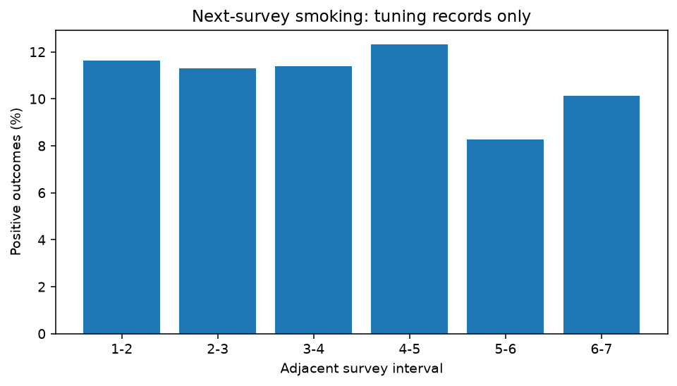
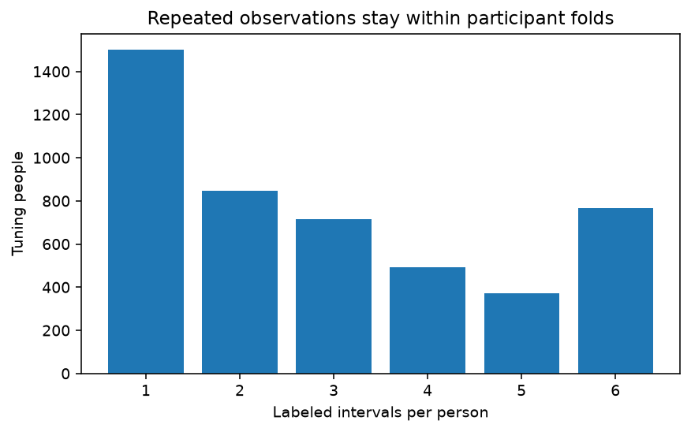
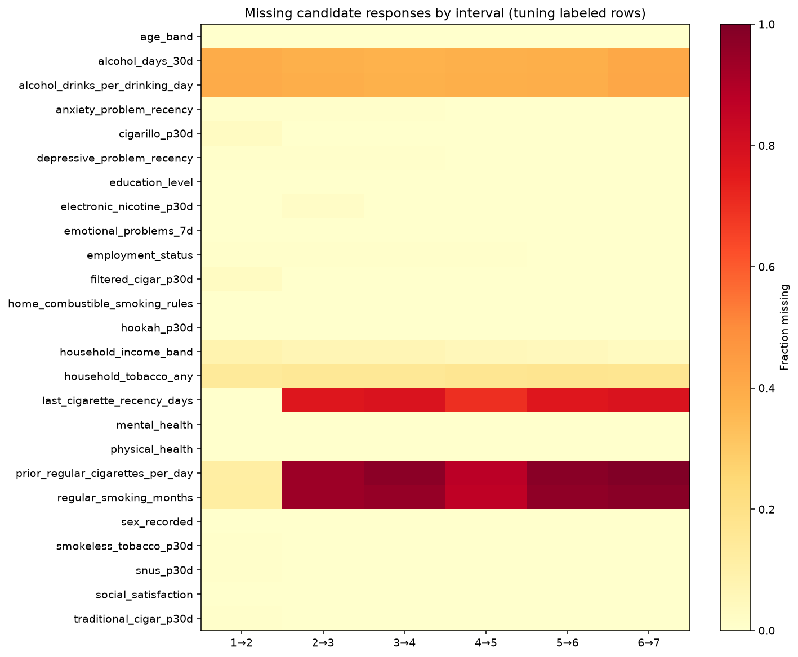
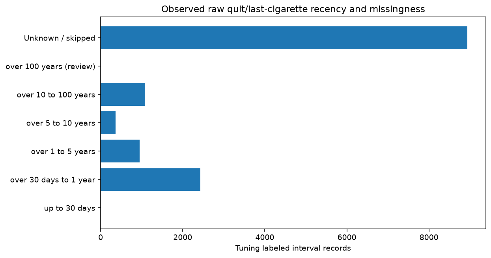
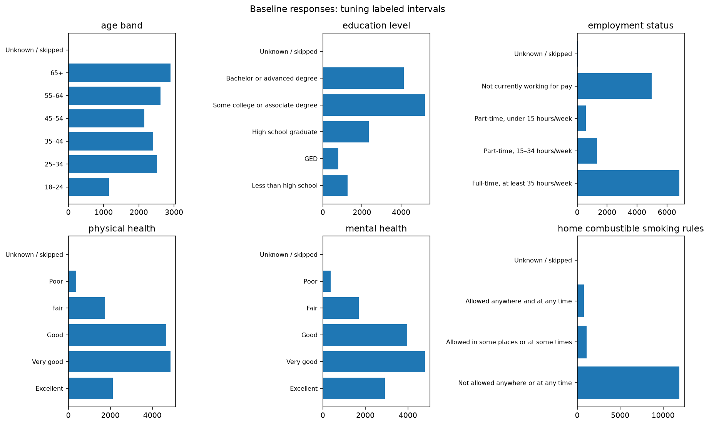
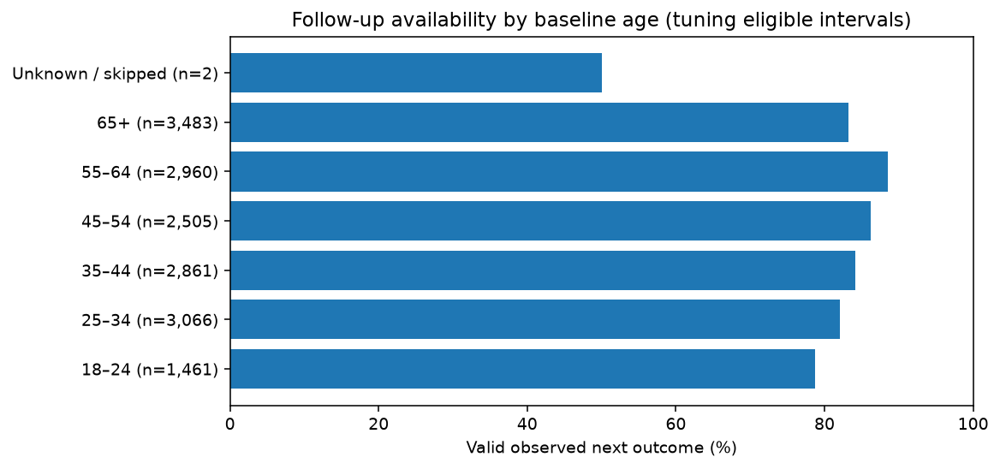

# Development data exploration and final predictor profiles

**Scope:** locked tuning participants only, starting Waves 1–6, before model development. Calibration and threshold groups and every held-out participant are excluded. No Wave 7→8 features or outcomes are explored. Cohort and participant assignment are unchanged. All summaries are unweighted with respect to the PATH survey design.

The tuning labeled sample has **13,757 intervals from 4,692 people**, including 1,487 positive next-survey smoking reports. Its baseline-eligible ledger has 16,338 intervals from 5,716 people; 2,581 lack a valid observed next outcome. These remain unobserved, never negative labels.

## Interval prevalence and repeated observations

| Interval | Observed records | People | Positive | Interval prevalence |
|---|---:|---:|---:|---:|
| 1-2 | 1,950 | 1,950 | 227 | 11.64% |
| 2-3 | 2,159 | 2,159 | 244 | 11.30% |
| 3-4 | 2,206 | 2,206 | 251 | 11.38% |
| 4-5 | 2,509 | 2,509 | 309 | 12.32% |
| 5-6 | 2,346 | 2,346 | 194 | 8.27% |
| 6-7 | 2,587 | 2,587 | 262 | 10.13% |



3,191 people contribute multiple labeled intervals; there are 9,065 records beyond each person's first. These are repeated observations, not independent participants. The aggregate repeat distribution is `{'1': 1501, '2': 848, '3': 714, '4': 493, '5': 370, '6': 766}`. Later metric weighting and participant-cluster bootstrap follow the locked evaluation protocol; no inferential intervals or models are fitted here.



## Missingness and conditional question availability



The following are observed-response percentages within labeled tuning intervals. Missing includes structural skips and no-answer reasons; it is not a valid zero. Exact reason counts for every candidate and interval are in `development_v1/missingness.json`.

| Feature | 1-2 | 2-3 | 3-4 | 4-5 | 5-6 | 6-7 |
|---|---:|---:|---:|---:|---:|---:|
| last_cigarette_recency_days | 99.7% | 23.1% | 22.1% | 30.3% | 23.7% | 22.2% |
| prior_regular_cigarettes_per_day | 88.4% | 6.1% | 2.7% | 12.4% | 2.2% | 0.7% |
| regular_smoking_months | 88.2% | 6.0% | 4.4% | 13.5% | 3.2% | 2.0% |
| household_tobacco_any | 85.6% | 84.4% | 84.5% | 83.6% | 82.5% | 82.9% |
| alcohol_days_30d | 60.7% | 61.8% | 62.7% | 62.1% | 61.6% | 59.2% |

Later-wave raw smoking-history questions often apply only to newly/recently former smokers or newly reported regular-smoking histories. Persistent former smokers can be structurally unasked. Wave 2 also has the documented quit-recency skip error. These patterns limit the interpretation of missingness and make a fully answered new-user history different from the training instrument. No missing duration is replaced with zero, no values are carried forward, and no extra completeness filter changes the cohort. Household questions are not generally asked of people living alone, so living alone must remain not applicable, not a fabricated No. Alcohol quantities are conditional; a skipped alcohol-days response cannot universally be inferred as zero.

## Numeric distributions and plausibility checks

| Feature (units) | Observed | Missing | Minimum | Median | 99th percentile | Maximum | Above review threshold |
|---|---:|---:|---:|---:|---:|---:|---:|
| last_cigarette_recency_days (approximate days) | 4,820 | 8,937 | 31.00 | 365.25 | 17166.75 | 25567.50 | 0 |
| prior_regular_cigarettes_per_day (cigarettes/day) | 2,294 | 11,463 | 1.00 | 15.00 | 60.00 | 400.00 | 13 |
| regular_smoking_months (months) | 2,411 | 11,346 | 0.00 | 120.00 | 600.90 | 804.00 | 0 |
| alcohol_days_30d (days/30 days) | 8,435 | 5,322 | 0.00 | 6.00 | 30.00 | 30.00 | 0 |
| alcohol_drinks_per_drinking_day (drinks/drinking day) | 8,380 | 5,377 | 1.00 | 2.00 | 12.00 | 60.00 | 4 |

Review thresholds are configured descriptive flags (>100 cigarettes/day, >30 drinks/drinking day, >100 years of quit recency or regular smoking), not documented hard validity bounds or proof of error. There are no negative observed numeric values. Category codes were checked against mapped labels. Source recoding already rejects documented invalid values and preserves their reasons. Thirteen tuning records report converted prior intensity above 100 cigarettes/day (maximum 400), and four report >30 drinks per drinking day (maximum 60). The documented source unit conversion uses 20 cigarettes per pack; high self-reports may still be errors or unusual reports. They remain flagged, unmodified in the locked cohort and research-only profile, not supplied by the app. Do not silently cap or impute using full-sample quantiles; any later research-model robust transformation or sensitivity must be fixed or learned within tuning training folds. No source response has been “corrected” to a guessed value.



The recency distribution uses fixed approximate-day bins, including an explicit unknown/skipped category. Wave 1 measures time since completely quitting; Waves 2–7 measure time since the last cigarette. Months and years convert to approximate days (30.4375 and 365.25). This is historical quit/last-use recency, not time until relapse or an exact event clock. A histogram of observed durations alone would hide substantial routing-related missingness.



## Follow-up availability and possible attrition bias

Only baseline-eligible tuning participants enter these comparisons, including intervals with no observed outcome. Selected baseline raw columns are read from canonical Waves 1–6 in chunks and immediately filtered to the tuning ledger IDs before harmonization. TSV has no participant predicate pushdown; unselected rows are discarded without summaries. No Wave 7/8 raw file is read. Source hashes, selected columns and rows harmonized are recorded in `development_v1/access_audit.json`. These early-wave reads allow baseline characteristics for unlabeled intervals, which the labeled-only cohort cannot supply.

| Baseline age | Eligible intervals | Valid observed outcomes | Availability |
|---|---:|---:|---:|
| 18–24 | 1,461 | 1,150 | 78.7% |
| 25–34 | 3,066 | 2,518 | 82.1% |
| 35–44 | 2,861 | 2,409 | 84.2% |
| 45–54 | 2,505 | 2,160 | 86.2% |
| 55–64 | 2,960 | 2,620 | 88.5% |
| 65+ | 3,483 | 2,899 | 83.2% |
| Unknown / skipped | 2 | 1 | 50.0% |



The pooled age groups show 78.7% observed follow-up at ages 18–24 versus 88.5% at 55–64; the unknown-age group has only two intervals and is too small for a substantive comparison. Unknown/skipped quit recency has 85.9% observed follow-up versus 81.0% in the over-30-day-to-one-year group. These are descriptive associations in an interval-weighted mix of waves, not evidence that age or quitting causes attrition. Baseline-characteristic groups overlap across intervals, and their wave composition differs. `development_v1/followup_by_baseline.json` provides pooled and per-wave counts for age, sex recorded, education, recency, physical health, mental health and electronic-product use. It separates missing interviews from present-but-unknown outcomes. Small cells are unstable; no causal claims, independence-based significance tests, missing-outcome imputations or national estimates are made. Differences suggest selection of the observed-outcome sample; they do not quantify or correct its bias.

## Final feature sets and app contract

**App (11 inputs):** `age_band`, `education_level`, `employment_status`, `last_cigarette_recency_days`, `electronic_nicotine_p30d`, `household_tobacco_any`, `home_combustible_smoking_rules`, `physical_health`, `mental_health`, `social_satisfaction`, `emotional_problems_7d`.

**Minimal comparison (4 inputs):** `age_band`, `education_level`, `employment_status`, `last_cigarette_recency_days`.

**Research comparison:** the original 25 documented candidates, using only actual baseline survey answers and missing values. It remains a distinct research profile; it is never an app fallback. Sparse intensity/duration questions and historical first-interview sex/gender cannot be replaced with invented new-user histories. Detailed tobacco, nominal-US-income, diagnostic-recency and alcohol questions add app burden and conditional measurement differences. The research profile is retained as a prespecified comparison, not a set selected by outcome associations or a claim of superior performance.

The app inputs were chosen for understandable meaning, answer burden and baseline availability/routing. No feature-versus-outcome screening, feature importance, association ranking or model fitting was performed. Explicitly keep the historically inherited sex/gender category research-only rather than substituting a new user’s current identity for an unavailable original recorded answer. Age/education/employment plus recency provide a basic, app-compatible minimal comparator. Recency remains sparse but is scientifically relevant; unknown is permitted and must be validated in later model stages. Household product scope and early e-cigarette versus later electronic-product definitions retain starting-wave prompts; they are not assumed measurement-invariant.

Exact eligibility gates, prompts, response labels/codes, per-wave product wording and recency units, and missing-answer behavior are in [the app questions](../docs/app_questions.md) and `configs/app_questions.json`. All model inputs are optional; untouched defaults, don’t know, refusal, not applicable and not previously asked each remain null with a distinct reason. There is no fabricated personal confidence percentage or validated probability yet. Do not offer a prediction when cohort eligibility is unknown/outside scope. Giving a new answer to a question formerly skipped by survey routing can cause distribution shift; filling a form is not proof of model applicability.

## Versioned mapping, unchanged locks and reproducibility

`configs/feature_mapping_final.json` retains complete source fields and attaches app/minimal/research membership. `docs/feature_dictionary_final.csv` adds profile columns to every original field/wave row. `configs/prediction_specification_final.json` sets the app allowlist and explicit alternative profiles while preserving the endpoint and cohort rules. The original JSON/CSV remain unchanged because their fingerprints are part of the existing cohort/split provenance. No cohort field, outcome, source column or recoding changed, so no regeneration or new participant assignment is necessary. Future fitting should explicitly call `path_project.final_inputs.fit_profile_pipeline` with a named profile; this delegates to the locked training boundary API.

Commands run from the workspace root with `.venv/bin/python`:

```bash
.venv/bin/python scripts/explore_development.py
.venv/bin/python scripts/finalize_inputs.py
.venv/bin/python scripts/write_development_summary.py
.venv/bin/python -m pytest -q -p no:cacheprovider
.venv/bin/python scripts/verify_evaluation_splits.py
.venv/bin/python scripts/verify_cohort.py
.venv/bin/python scripts/verify_inputs.py
```

These commands explore tuning data and write aggregate reports/figures only. No base model, calibrator, threshold, final-test evaluation, external service, Git operation or deployment occurs. Dependency versions remain in `requirements-lock.txt`; stage 6 provenance is saved separately. Stop here and await the next numbered stage.
