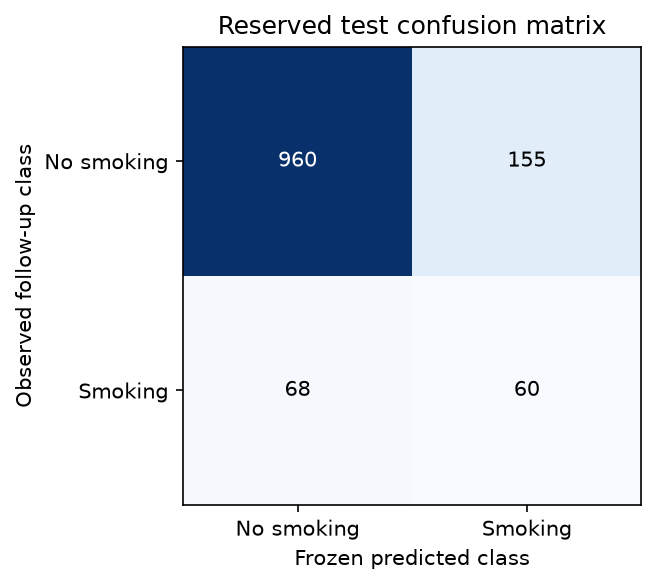
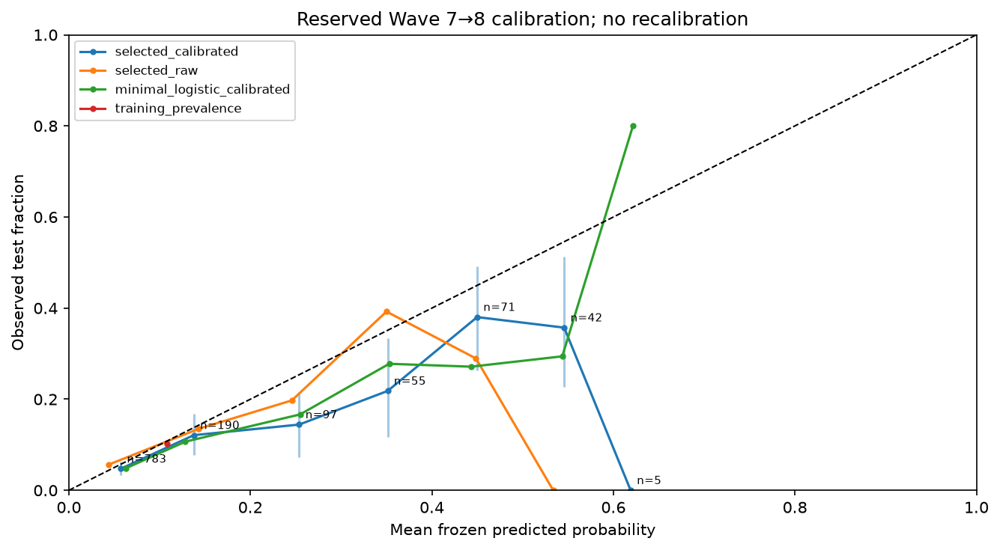
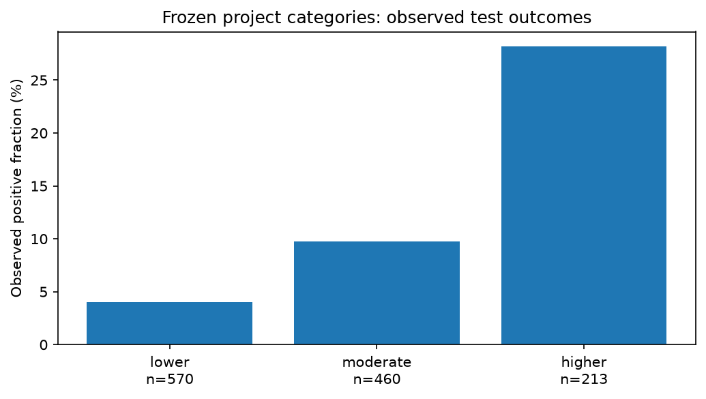

# Final reserved-test evaluation

**One frozen evaluation; no test-driven model selection, fitting, recalibration, regrouping or threshold changes.** The selected model is still the stage 8 four-input XGBoost with its development-fitted sigmoid and binary threshold. Final results are valid evidence even when weak. This is an unweighted local PATH research project, not a nationally representative or clinically validated prediction tool.

Model version: `xgb_minimal_s1_none:9b46cdb1783302c05c3b56b83d5695a1ad58b90da0614f04188ee687170eae36`. Evaluation signature: `0b301df0a9a28468b25d24c5b9e478a4df8859bdbc350cf73a3da90cf04b5e30`. Pre-test artifacts/code/schema/hyperparameters/categories/timing are saved in `artifacts/final_evaluation_v1/frozen/` and `pretest_freeze.json`, before the recorded answer access in `exposure_log.jsonl`.

## Cohort, endpoint and prevalence

Past-30-day cigarette smoking reported at next scheduled survey among eligible former established smokers, conditional on valid observed follow-up

Reserved pair: **Wave 7→8** from the label-blind held-out participant group. All these people's earlier records were excluded from fitting/development. **1,243 records from 1,243 people**, **128 positive** and **1,115 negative** outcomes; positive prevalence **10.30%**. People with repeated test records: 0. No all-eight-wave participation or test-feature completeness filter was imposed.

A positive is reported cigarette use in the next interview’s 30-day window, not the exact first resumption, any resumption during the whole interval, or persistent relapse. A negative window does not prove continuous abstinence. The cohort is conditional on valid observed next-wave outcomes; missing follow-up is not a negative label. These estimates do not remove informative attrition or instrument/routing changes. Individual elapsed intervals are unavailable.

Observed selected-input coverage: 1,243/1,243 records meet the frozen 2-input usability count. All locked records remain in classifier evaluation; the application guard is a separate coverage description and does not justify a post-hoc test exclusion or new-user accuracy guarantee.

## Selected frozen classifier

95% intervals are participant-cluster percentile bootstrap intervals conditional on this fitted model and observed follow-up sample. Parentheses give valid/attempted replicates. They do not include model-selection, survey-design or all population-generalization uncertainty.

| Metric | Point [95% interval] (valid/attempted) |
|---|---|
| prevalence | 0.1030 [0.0869, 0.1199] (1000/1000) |
| average_precision | 0.2447 [0.1961, 0.3146] (1000/1000) |
| roc_auc | 0.7392 [0.6955, 0.7810] (1000/1000) |
| brier | 0.0885 [0.0782, 0.0993] (1000/1000) |
| log_loss | 0.3051 [0.2751, 0.3365] (1000/1000) |
| mean_probability | 0.1390 [0.1315, 0.1467] (1000/1000) |
| precision | 0.2791 [0.2170, 0.3351] (1000/1000) |
| recall | 0.4688 [0.3828, 0.5547] (1000/1000) |
| specificity | 0.8610 [0.8415, 0.8805] (1000/1000) |
| f1 | 0.3499 [0.2831, 0.4107] (1000/1000) |

Operating threshold: **0.25900495997065093**, frozen on development data. Average precision is stepwise weighted precision over recall increments, matching sklearn average_precision_score; it is **not trapezoidal PR-AUC**. Compare AP to the reported positive prevalence. ROC measures ranking; Brier/log loss measure probability quality. Precision can be undefined if no positive predictions; it is not silently replaced with zero.

Confusion matrix uses the actual test record counts at the frozen threshold. Participant and interval metrics are both saved. With one record per test person they coincide; the implementation still supports participant-cluster uncertainty for repeated observations.

## Frozen baseline comparisons

All comparator pipelines/calibrators and thresholds were saved before test answers were accessed. Raw baseline models use a fixed diagnostic 0.5 threshold, while calibrated comparators retain their development-selected thresholds. These threshold metrics answer different operating-point choices, so probability/ranking comparisons should also be read. No comparator is promoted or retuned because of this table. Stage 7 training-prevalence-only predictions remain their **training prevalence**, not test prevalence. Raw class-weighted outputs are not silently recalibrated on the test.

| Frozen model | AP [95% CI] | ROC [95% CI] | Brier [95% CI] | Log loss | Threshold |
|---|---|---|---|---:|---:|
| selected_calibrated | 0.2447 [0.1961, 0.3146] (1000/1000) | 0.7392 [0.6955, 0.7810] (1000/1000) | 0.0885 [0.0782, 0.0993] (1000/1000) | 0.3051 | 0.259005 |
| selected_raw | 0.2447 [0.1961, 0.3146] (1000/1000) | 0.7392 [0.6955, 0.7810] (1000/1000) | 0.0851 [0.0735, 0.0970] (1000/1000) | 0.2980 | 0.500000 |
| training_prevalence | 0.1030 [0.0869, 0.1199] (1000/1000) | 0.5000 [0.5000, 0.5000] (1000/1000) | 0.0924 [0.0798, 0.1056] (1000/1000) | 0.3317 | 0.500000 |
| minimal_logistic | 0.2759 [0.2158, 0.3566] (1000/1000) | 0.7367 [0.6897, 0.7801] (1000/1000) | 0.0848 [0.0738, 0.0969] (1000/1000) | 0.2976 | 0.500000 |
| minimal_logistic_balanced | 0.2800 [0.2209, 0.3592] (1000/1000) | 0.7407 [0.6938, 0.7827] (1000/1000) | 0.1801 [0.1693, 0.1911] (1000/1000) | 0.5492 | 0.500000 |
| app_logistic | 0.2796 [0.2196, 0.3589] (1000/1000) | 0.7436 [0.6980, 0.7875] (1000/1000) | 0.0846 [0.0733, 0.0967] (1000/1000) | 0.2964 | 0.500000 |
| app_logistic_balanced | 0.2822 [0.2238, 0.3624] (1000/1000) | 0.7471 [0.7020, 0.7895] (1000/1000) | 0.1841 [0.1726, 0.1956] (1000/1000) | 0.5599 | 0.500000 |
| minimal_logistic_calibrated | 0.2759 [0.2158, 0.3566] (1000/1000) | 0.7367 [0.6897, 0.7801] (1000/1000) | 0.0880 [0.0777, 0.0988] (1000/1000) | 0.3049 | 0.166777 |

Paired differences use the same participant draws for all models: selected minus comparator; positive AP/ROC favors selected, negative Brier favors selected. These descriptive comparisons do not authorize choosing a new test winner.

| Comparator | AP difference 95% CI | ROC difference 95% CI | Brier difference 95% CI |
|---|---|---|---|
| selected_raw | [0.0000, 0.0000] (1000 valid) | [0.0000, 0.0000] (1000 valid) | [0.0012, 0.0057] (1000 valid) |
| training_prevalence | [0.1003, 0.2062] (1000 valid) | [0.1955, 0.2810] (1000 valid) | [-0.0109, 0.0030] (1000 valid) |
| minimal_logistic | [-0.0669, 0.0044] (1000 valid) | [-0.0076, 0.0140] (1000 valid) | [0.0007, 0.0070] (1000 valid) |
| minimal_logistic_balanced | [-0.0707, 0.0022] (1000 valid) | [-0.0117, 0.0096] (1000 valid) | [-0.1018, -0.0808] (1000 valid) |
| app_logistic | [-0.0756, 0.0070] (1000 valid) | [-0.0201, 0.0127] (1000 valid) | [0.0006, 0.0071] (1000 valid) |
| app_logistic_balanced | [-0.0803, 0.0055] (1000 valid) | [-0.0245, 0.0097] (1000 valid) | [-0.1069, -0.0837] (1000 valid) |
| minimal_logistic_calibrated | [-0.0669, 0.0044] (1000 valid) | [-0.0076, 0.0140] (1000 valid) | [-0.0017, 0.0028] (1000 valid) |

## Calibration and honest probability limitations

Bins are fixed before test access at 0.0, 0.1, …, 1.0. Empty bins have no observed rate. Selected-model points are annotated with record counts; sparse bins and percentile intervals can be unstable or degenerate. Saved calibration tables include all bins and valid/undefined bootstrap counts. No intercept, slope or recalibrator is fitted on this test.

Selected calibrated mean probability is **0.1390** versus observed prevalence **0.1030**. Its Brier **0.0885** is **higher** than the same frozen raw model’s **0.0851**. This is reported as measured; calibration is not assumed to transfer perfectly from earlier-wave development. Differences may reflect observation/period/weighting-target shifts, but this evaluation does not establish their causes. The sigmoid is not changed in response.

## Frozen project risk categories

Cuts: 0.075074776528041801 and 0.25900495997065093. Lower includes the lower cut; moderate includes the upper cut; higher is strictly above it. These development-defined relative strata are not medical cutoffs. Their test outcomes are evaluated without moving a cut. Rates below refer to eligible observed-outcome held-out Wave 7→8 records with the listed denominators, not all PATH participants or a national population.

| Category | Records | People | Positive records | Observed fraction [95% CI] | Mean probability |
|---|---:|---:|---:|---|---:|
| lower | 570 | 570 | 23 | 0.0404 [0.0246, 0.0579] (1000 valid) | 0.0444 |
| moderate | 460 | 460 | 45 | 0.0978 [0.0717, 0.1261] (1000 valid) | 0.1280 |
| higher | 213 | 213 | 60 | 0.2817 [0.2207, 0.3427] (1000 valid) | 0.4158 |

A category with no observed positive outcomes does not have proven zero future risk; empirical bootstrap bounds can be degenerate and do not rule out unobserved events. Differences in category rates are descriptive, not an intervention effect or a personal confidence percentage.

## Prespecified recent-use and demographic subgroups

Definitions and minimums were frozen before exposure: at least 100 people, 20 positive and 20 negative records for subgroup performance estimates. Counts and outcome-rate uncertainty are retained for smaller groups, with performance suppressed rather than regrouping or weakening thresholds. Group comparisons are exploratory, multiple and not powered fairness/causal claims. The overlapping recent boundary sensitivity is not a separate independent cohort.

Recent means observed raw last-cigarette recency >30 to ≤365.25 approximate days; longer means >365.25; unknown duration stays unknown, never zero or presumed long-term. The boundary-excluded sensitivity uses the already-documented raw one-month/twelve-month/one-year reports. Conditional questionnaire routing makes observed-duration groups selected subsets, not all quitters. Age groups use published bands, not invented exact ages. Recorded male/female categories may inherit a historical first interview and are not current gender identity; unknown is retained.

| Subgroup | Records / people | Positives | Observed rate [95% CI] | Performance supported |
|---|---:|---:|---|---|
| recent_observed_last_use_30_to_365_25_days | 191/191 | 57 | 0.2984 [0.2356, 0.3613] | yes |
| longer_observed_last_use_over_365_25_days | 92/92 | 16 | 0.1739 [0.0978, 0.2500] | no: size/event minimum |
| unknown_last_use_recency | 960/960 | 55 | 0.0573 [0.0437, 0.0729] | yes |
| recent_boundary_excluded_sensitivity | 157/157 | 46 | 0.2930 [0.2229, 0.3694] | yes |
| age_18–34 | 357/357 | 59 | 0.1653 [0.1289, 0.2045] | yes |
| age_35–54 | 434/434 | 50 | 0.1152 [0.0875, 0.1452] | yes |
| age_55+ | 452/452 | 19 | 0.0420 [0.0243, 0.0619] | no: size/event minimum |
| age_unknown | 0/0 | 0 | undefined [undefined, undefined] | no: size/event minimum |
| recorded_sex_Male (survey recorded) | 643/643 | 71 | 0.1104 [0.0871, 0.1337] | yes |
| recorded_sex_Female (survey recorded) | 598/598 | 57 | 0.0953 [0.0736, 0.1204] | yes |
| recorded_sex_unknown | 2/2 | 0 | 0.0000 [0.0000, 0.0000] | no: size/event minimum |

| Supported subgroup | AP [95% CI] | ROC [95% CI] | Brier [95% CI] | Precision [95% CI] | Recall [95% CI] | Specificity [95% CI] |
|---|---|---|---|---|---|---|
| recent_observed_last_use_30_to_365_25_days | 0.3188 [0.2438, 0.4238] (1000/1000) | 0.5638 [0.4787, 0.6569] (1000/1000) | 0.2272 [0.2096, 0.2433] (1000/1000) | 0.3017 [0.2389, 0.3699] (1000/1000) | 0.9474 [0.8772, 1.0000] (1000/1000) | 0.0672 [0.0301, 0.1104] (1000/1000) |
| unknown_last_use_recency | 0.0967 [0.0673, 0.1554] (1000/1000) | 0.6419 [0.5667, 0.7137] (1000/1000) | 0.0543 [0.0434, 0.0660] (1000/1000) | 0.1250 [0.0000, 0.3077] (1000/1000) | 0.0364 [0.0000, 0.0944] (1000/1000) | 0.9845 [0.9755, 0.9922] (1000/1000) |
| recent_boundary_excluded_sensitivity | 0.3090 [0.2314, 0.4111] (1000/1000) | 0.5661 [0.4703, 0.6549] (1000/1000) | 0.2310 [0.2173, 0.2456] (1000/1000) | 0.2949 [0.2272, 0.3631] (1000/1000) | 1.0000 [1.0000, 1.0000] (1000/1000) | 0.0090 [0.0000, 0.0286] (1000/1000) |
| age_18–34 | 0.2728 [0.2030, 0.3723] (1000/1000) | 0.6852 [0.6061, 0.7606] (1000/1000) | 0.1405 [0.1210, 0.1608] (1000/1000) | 0.2754 [0.2017, 0.3459] (1000/1000) | 0.6441 [0.5166, 0.7727] (1000/1000) | 0.6644 [0.6109, 0.7172] (1000/1000) |
| age_35–54 | 0.2722 [0.1750, 0.4170] (1000/1000) | 0.6931 [0.5997, 0.7774] (1000/1000) | 0.0939 [0.0748, 0.1149] (1000/1000) | 0.3214 [0.1967, 0.4446] (1000/1000) | 0.3600 [0.2281, 0.5000] (1000/1000) | 0.9010 [0.8698, 0.9299] (1000/1000) |
| recorded_sex_Male (survey recorded) | 0.2958 [0.2229, 0.4096] (1000/1000) | 0.7557 [0.6922, 0.8146] (1000/1000) | 0.0886 [0.0740, 0.1054] (1000/1000) | 0.3431 [0.2571, 0.4375] (1000/1000) | 0.4930 [0.3704, 0.6154] (1000/1000) | 0.8829 [0.8566, 0.9086] (1000/1000) |
| recorded_sex_Female (survey recorded) | 0.2036 [0.1392, 0.2890] (1000/1000) | 0.7187 [0.6482, 0.7790] (1000/1000) | 0.0888 [0.0746, 0.1039] (1000/1000) | 0.2212 [0.1455, 0.2942] (1000/1000) | 0.4386 [0.3077, 0.5625] (1000/1000) | 0.8373 [0.8047, 0.8673] (1000/1000) |

No subgroup-specific feature selection, calibration or thresholds are fitted. Uncertain/small strata cannot establish reliability for an individual demographic group. Missing-recency performance is included where supported because missingness can encode survey routing, not because unknown duration means a particular quit history.

## Bootstrap and undefined metrics

Participant-cluster percentile bootstrap; same participant draws for model comparisons; repeated rows travel together and each drawn cluster occurrence has total metric weight one. No-positive AP and one-class ROC undefined; undefined denominators omitted metric-by-metric with counts.

Seed **366**, **1000** replicates. The whole observed participant cluster is sampled with replacement, and each sampled occurrence contributes one total metric weight even if a participant is drawn more than once. Because this outer test has one row/person, this reduces to resampling people/records. Paired comparisons share draws. Subgroup/rate intervals resample participants within the reported subgroup. A no-positive AP or absent-class ROC is undefined; zero-denominator precision/recall/specificity/F1 is undefined. CIs omit only that metric’s undefined replicates and report valid/undefined counts; no new seed is searched. Other valid metrics are retained.

The custom cached-order weighted AP/ROC implementation was tested against sklearn on synthetic tied/weighted data before test access. It avoids repeated sorting during bootstrap without changing the metric definition. Probability losses use the frozen machine-epsilon clip. These are empirical conditional intervals, not total predictive uncertainty or personal confidence.

## Timing, exposure record and stop point

C; no survival model or supported elapsed horizons
. No separate timing model/horizon is supported, so no survival metrics, annual probabilities or relapse dates are mixed with classification.

The exposure log records the completed pre-test freeze, the start of the sole test answer read, the saved prediction-checkpoint hash and evaluation completion. There was no test-driven fitting/tuning. All reported values come from that frozen code and those saved predictions. Fitted Pipelines/calibrators, schemas/hyperparameters, thresholds, category/timing decisions, package versions and code copies are in the pre-test snapshot. All participant-level test predictions/subgroup fields stay in ignored `artifacts/final_evaluation_v1/test_predictions.parquet`; public results/figures are aggregates only.

Completed retries verify and reuse saved final results; they do not rescore, rebootstrap or select another model. If an implementation bug or incomplete exposed run is found, preserve the log/checkpoint and record the specific fix, prior exposure and implications before any recovery. Never conceal a repeated evaluation or present a revised post-test model as untouched. Earlier immutable app metadata retains its historical pending-test text; `configs/final_evaluation_status.json` supplies current completion evidence without rewriting old artifacts. New-user/clinical validity and national representativeness remain unestablished regardless of these metrics.

Weak results are retained as valid research outcomes. Stop at stage 11; await the next numbered prompt. No publication, deployment or external messaging occurred.
